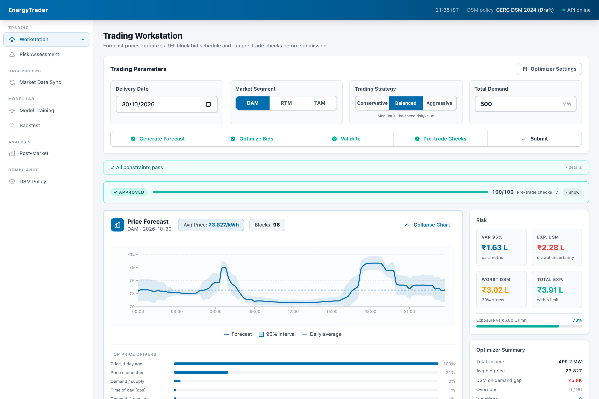
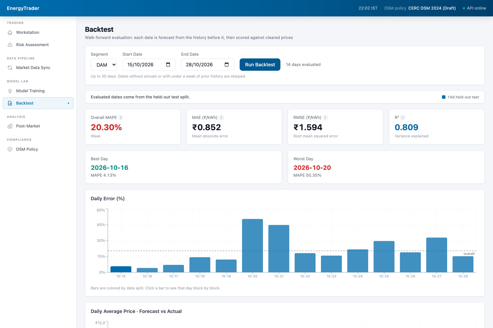

# EnergyTrader

[](https://github.com/kartikmadan11/EnergyTrader/actions/workflows/ci.yml)

A bidding workstation for Indian power exchanges.
It forecasts 15-minute clearing prices, builds a bid schedule with a linear program, runs pre-trade checks against the active DSM regulation, and reviews outcomes once the market clears.



## Workflow

1. **Sync market data.** Pull Day-Ahead (DAM), Real-Time (RTM) and Term-Ahead (TAM) prices from IEX, then enrich them with weather and holiday features.
2. **Train a model.** Fit one gradient-boosted model per segment on 31 engineered features, with optional cross-validated tuning.
3. **Forecast.** Predict all 96 blocks for a delivery date with a 95% interval per block.
4. **Optimize bids.** Allocate volume across blocks with an LP that weighs bid value against DSM penalty exposure and forecast uncertainty.
5. **Run pre-trade checks.** Seven hard and soft checks produce a verdict; hard failures block submission, and the server re-runs them on submit.
6. **Submit.** Record the bid set against a session, with every step written to the audit trail.
7. **Review.** Compare forecasts and bids with cleared prices: forecast error, bid hit rate, basket rate and uncleared DSM exposure.

## Quick start

Requirements: Python 3.13 with [uv](https://docs.astral.sh/uv/), and Node.js 20 or later.

```bash
make install         # uv sync + npm ci
cp .env.example .env # optional; every setting has a default
make dev             # API on :8000, web app on :3000
```

Open http://localhost:3000 and follow the workflow above.
The database starts empty, so begin on **Market Data Sync**, then **Model Training**, then the **Workstation**.
Interactive API docs are at http://localhost:8000/docs.

## Architecture

```
backend/                 FastAPI, async SQLAlchemy on SQLite
├── main.py              App factory, CORS, router registration, scheduler lifecycle
├── common/              Config, database, ORM models, schemas, DSM policy loader, HTTP client
├── forecast_service/    Feature engineering, model training, prediction, backtest, metrics
├── bid_engine_service/  LP optimizer, constraint validation, submission
├── approval_service/    Pre-trade checks and verdict
├── risk_service/        Cost-at-risk and DSM exposure
├── audit_service/       Audit log and post-market analysis
├── policy_service/      List, activate, compare and edit DSM regulations
├── scraper_service/     Market data sync and enrichment endpoints
├── jobs/                Nightly scrape, enrich, score and retrain pipeline
└── data/                Scrapers, policy YAML, local database and model files

frontend/                Next.js 14 (App Router), Tailwind CSS, Recharts
└── src/
    ├── app/             Workstation, risk, sync, training, backtest, post-market, policy
    ├── components/      Sidebar, status bar, shared UI
    └── lib/             Typed API client and formatting helpers
```

The web app proxies `/api/*` to the backend, so the browser only talks to one origin.

## How it works

### Forecasting

Each segment gets its own `HistGradientBoostingRegressor`.
Features cover time of day and calendar, cyclical encodings, price lags and rolling statistics, price momentum, lagged grid state, weather and holidays; see [docs/FEATURES.md](docs/FEATURES.md).
Every lag and rolling feature is shifted so that a forecast only sees data published before the delivery date.
The interval is `prediction ± 1.96σ`, where σ is the larger of half the block's 7-day price standard deviation and 8% of the prediction.
This is a heuristic band rather than a calibrated one; the roadmap covers replacing it.

The **Backtest** page is the source of truth for accuracy.
It walks forward through a date range, forecasts each day from the history before it only, and labels each date as train, held-out test or unseen.
MAPE ignores blocks priced below ₹1/kWh, where percentage error is meaningless, and falls back to sMAPE when no block qualifies.



### Bid optimization

Bid prices are fixed per block at the forecast plus a strategy offset scaled by volatility, clamped to the policy's price band.
Volumes are the LP decision variables, solved with HiGHS through PuLP.
The objective trades bid value against two penalties:

- DSM deviation from a uniform schedule, linearized into a base band and a severe tier that carries the policy's surcharge.
- Forecast uncertainty, priced as interval width times volume.

The weights are `λ = (1 - risk_tolerance) × base`, so conservative, balanced and aggressive strategies differ only in their offset, tolerance and volume scale.
Base weights come from `SOLVER_LAMBDA1_BASE` and `SOLVER_LAMBDA2_BASE`, and the Workstation can grid-search them per delivery date.

### DSM policy as code

Each regulation version is a YAML file in `backend/data/policies/`.
It defines the price band, deviation band, penalty rate, severe threshold and multiplier, and technical minimum.
The active policy drives the optimizer, validation, risk and pre-trade checks.
Switching or editing it from the **DSM Policy** page takes effect on the next request and is audited.

### Pre-trade checks

| Check | Type | Fails when |
| --- | --- | --- |
| Coverage | Hard | Any of the 96 blocks has no bid |
| Constraint compliance | Hard | A bid breaks the price band or technical minimum |
| Risk exposure | Hard | Total exposure exceeds the alert limit |
| Price ceiling | Hard | A bid sits at the price ceiling; near-ceiling bids warn outside the aggressive strategy |
| Forecast confidence | Soft | Blocks lack a forecast, or over 20% have intervals wider than 2.5x the price |
| Override ratio | Soft | Over 40% of blocks were edited by hand |
| Strategy alignment | Soft | Conservative bids average over 10% above forecast, or aggressive bids over 5% below |

The verdict is `APPROVED`, `APPROVED_WITH_FLAGS`, `NEEDS_REVISION` or `REJECTED`.
`POST /api/bids/submit` re-runs the checks on the server and returns `422` with the failing checks if the bid set is blocked.

### Risk

Cost-at-risk treats each block's clearing price as normal with the forecast σ and assumes block errors are perfectly correlated, which gives a conservative 95% bound.
DSM exposure applies the active policy's tiered penalty to a deviation proxied by the forecast's relative interval width.
Total exposure is cost-at-risk plus expected DSM penalty, and an alert fires above `RISK_VAR_THRESHOLD_INR`.

### Post-market review and nightly pipeline

Post-market analysis scores the forecast and the latest submitted session for a delivery date against cleared prices.
A bid clears when its price is at or above the market clearing price.
With `SCHEDULER_ENABLED=true`, a nightly job in IST scrapes the previous day, scores yesterday's forecast into the audit log, retrains each segment, and enriches the new rows half an hour later.
Setting `SCHEDULER_RETRAIN_ENABLED=false` limits retraining to segments whose MAPE exceeded `FEEDBACK_MAPE_THRESHOLD`.

## API

| Method | Endpoint | Purpose |
| --- | --- | --- |
| `POST` | `/api/scraper/trigger` | Sync a segment for a date range |
| `POST` | `/api/scraper/enrich` | Start weather and holiday enrichment |
| `POST` | `/api/forecast/train` | Train a segment model |
| `GET` | `/api/forecast/predict` | 96-block forecast for a delivery date |
| `GET` | `/api/forecast/evaluate` | Walk-forward backtest |
| `GET` | `/api/bids/recommend` | Optimized bid schedule |
| `GET` | `/api/bids/tune` | Grid-search the LP weights |
| `POST` | `/api/bids/validate` | Check bids against the active policy |
| `POST` | `/api/bids/request-approval` | Run the pre-trade checks |
| `POST` | `/api/bids/submit` | Submit a bid set |
| `POST` | `/api/risk/assess` | Cost-at-risk and DSM exposure |
| `GET` | `/api/audit/log` | Audit trail |
| `GET` | `/api/audit/post-market` | Post-market analysis |
| `GET` | `/api/policy/active` | Active DSM regulation |

See http://localhost:8000/docs for the full list and schemas.

## Configuration

All settings are environment variables with working defaults.
[.env.example](.env.example) documents each one, and `make` loads `.env` for both services.

## Development

```bash
make lint    # ruff check, ruff format --check, ESLint, tsc
make test    # pytest
make check   # lint, test and a production build
```

CI runs the same checks on every pull request and on every push to `main`.

## Scope and limitations

- Submission records the bid set and its audit trail locally; it does not place orders on an exchange.
- There is no authentication yet, so run it on a trusted network only.
- Weather comes from Open-Meteo for a single location (Delhi NCR) as a proxy for northern-region load.
- Forecast accuracy depends on how much history you sync; measure it on the Backtest page before relying on it.

[docs/ROADMAP.md](docs/ROADMAP.md) covers the planned Rust trading core, trade blotter and authenticated access.
