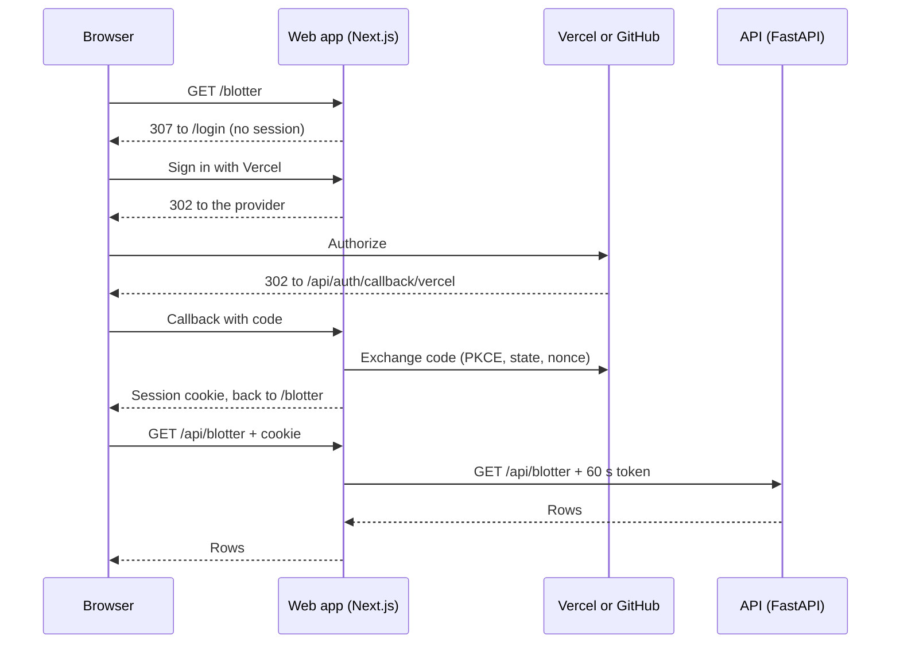

# Sign-in and deployment

EnergyTrader signs people in through the web app with [Auth.js](https://authjs.dev), using Sign in with Vercel or GitHub.
The API never sees a browser session.
Instead, the web app attaches a short-lived token naming the signed-in user to every API call, and the API records that name in the audit trail.
This document covers how that works, how to set up each provider, and how to deploy the web app on Vercel with the API hosted elsewhere.

## How it works



- `frontend/src/auth.ts` configures Auth.js.
  A provider is enabled only when its client id is set.
- `next dev` also offers a name-only sign-in, so the app runs locally without an OAuth app.
  It is not registered in production builds.
- A signed-in user is identified as `<provider>:<username>`, such as `vercel:desk-north` or `github:desk-north`.
  Sign in with Vercel uses the `preferred_username` claim, and GitHub uses the account's login.
- An OAuth sign-in succeeds only if that id is admitted by `AUTH_ALLOWED_USERS`.
  A refused account sees its id on the sign-in page, so an administrator can add it.
- The session is an encrypted JWT in an `HttpOnly`, `SameSite=Lax` cookie, and there is no user database.
  It ends 12 hours after sign-in, however active it stays, so everyone signs in once per trading day.
- Every request that reads the session checks its account against `AUTH_ALLOWED_USERS` again.
  Removing an id from the list therefore signs that person out on their next request, without waiting for the cookie to expire.
- `frontend/src/proxy.ts` runs before every request.
  The landing page and `/login` are public, and every other page redirects to `/login` without a session.
  New pages are therefore protected unless they are added to the public list.
- For `/api/*` requests, the proxy drops the browser's cookie and `Authorization` header and adds a 60 second HS256 token signed with `API_AUTH_SECRET`.
  The API (`backend/common/auth.py`) checks its signature, algorithm, issuer, audience and expiry, and rejects every route except `/api/health` without a valid token.
- The `(app)` layout checks the session again, so a page is not served on the strength of the proxy alone.

## Running locally

`make dev` works with no configuration.
Sign in from http://localhost:3000 with any display name, which becomes `local:<name>`.

Without `API_AUTH_SECRET`, the API trusts every caller as `local` and logs a warning at startup, so the audit trail does not show the name you signed in with.
To see named actors locally, put the same random value in `.env` for both services:

```bash
API_AUTH_SECRET=$(openssl rand -hex 32)
```

## Allowlist

`AUTH_ALLOWED_USERS` is a comma-separated list of entries, matched without regard to case.

| Entry | Admits |
| --- | --- |
| `github:desk-north` | That one account |
| `vercel:*` | Every account the Vercel app lets sign in |
| `*` | Every account any enabled provider authenticates |

An empty or missing list admits nobody, so a deployment that forgets to set it fails closed.
Avoid `*` and `github:*`, which admit anyone with a GitHub account.

Ids use usernames, so the audit trail is readable.
The trade-off is that a renamed account signs in under a new id, which must be added to the list, and its earlier history stays under the old id.
A released username can also be registered by someone else, so remove ids from the list when people leave.
`vercel:*` with Sign-In Access limited to team members avoids both problems, because Vercel checks team membership on every sign-in.

## Sign in with Vercel

Sign in with Vercel is an OpenID Connect provider.
Auth.js reads its endpoints from `https://vercel.com/.well-known/openid-configuration` and requests the `openid`, `email` and `profile` scopes.

1. In the Vercel dashboard, open your team's **Settings**, select **Apps**, and click **Create**.
   Give the app a name such as EnergyTrader and save it.
2. On the app's page, generate a client secret.
   Set the client id as `AUTH_VERCEL_ID` and the secret as `AUTH_VERCEL_SECRET`.
   An app can have two active secrets at a time, so a secret can be rotated without downtime.
3. Under **Authorization Callback URLs**, add `http://localhost:3000/api/auth/callback/vercel` for local development.
   For the deployed app, select its Vercel project instead of typing a domain.
   The callback then matches every deployment of the project, including previews.
4. On the **Permissions** page, allow the `openid`, `email` and `profile` scopes.
5. On the **General** page, set **Sign-In Access** to **Members of the team**.
   Then `AUTH_ALLOWED_USERS=vercel:*` admits exactly the team.
   Removing someone from the team stops new sign-ins, and their current session ends at most 12 hours after they signed in.
   To end it at once, rotate `AUTH_SECRET`, which signs everyone out.

## GitHub

1. In GitHub, open **Settings**, then **Developer settings**, then **OAuth Apps**, and click **New OAuth App**.
2. Set the homepage URL to the site and the authorization callback URL to `https://<your-domain>/api/auth/callback/github`.
3. Generate a client secret.
   Set the client id as `AUTH_GITHUB_ID` and the secret as `AUTH_GITHUB_SECRET`.

A GitHub OAuth app has a single callback URL, so use a separate app for local development with `http://localhost:3000/api/auth/callback/github`.
Preview deployments need the redirect proxy described below.

## Deploying the web app on Vercel

1. Import the repository into Vercel and set the project's **Root Directory** to `frontend`.
   Vercel detects Next.js and runs `npm run build`.
2. Add these environment variables to the Production and Preview environments.

| Variable | Value |
| --- | --- |
| `AUTH_SECRET` | A random value from `openssl rand -base64 32`; it encrypts session cookies |
| `AUTH_VERCEL_ID`, `AUTH_VERCEL_SECRET` | From the Vercel app |
| `AUTH_GITHUB_ID`, `AUTH_GITHUB_SECRET` | From the GitHub OAuth app, if GitHub sign-in is wanted |
| `AUTH_ALLOWED_USERS` | Such as `vercel:*,github:desk-north` |
| `API_AUTH_SECRET` | The same value the API uses |
| `BACKEND_URL` | The API's HTTPS origin, such as `https://api.example.com` |

Auth.js trusts the request's host on Vercel, so `AUTH_URL` and `AUTH_TRUST_HOST` are not needed there.
On any other host, set `AUTH_TRUST_HOST=true` when a reverse proxy you control sets the host header, or set `AUTH_URL` to the public origin.

A production build refuses to call the API when `API_AUTH_SECRET` is missing, and returns a 500 that names the variable rather than sending unauthenticated requests.

### Preview deployments

Sign in with Vercel works on previews directly once its callback is bound to the project.

GitHub can only redirect to its one registered callback, so previews sign in through production with the Auth.js redirect proxy:

1. Keep the GitHub app's callback on the production domain.
2. Set `AUTH_REDIRECT_PROXY_URL=https://<production-domain>/api/auth` in both Production and Preview.
3. Use the same `AUTH_SECRET` in both environments, because production decodes the state that the preview created.

Vercel's Deployment Protection is on for previews by default, so only team members can open a preview at all.
Production stays public, which keeps the landing page reachable while sign-in protects everything else.

## Hosting the API

The API is a long-running FastAPI process with a SQLite database, trained model files and an optional nightly scheduler.
It needs a persistent disk and a process that stays up, so it does not suit serverless functions.
Run it on a container host or a virtual machine with a volume for `backend/data`, behind HTTPS.

1. Set `API_AUTH_SECRET` on the API to the same value as the web app.
   The API then rejects any request without a valid token, so it can sit on the public internet.
2. Set `BACKEND_URL` in Vercel to the API's origin.
   The browser only ever talks to the web app, which forwards `/api/*` to `BACKEND_URL`, so the API needs no CORS configuration.
3. Keep the clocks on both hosts in sync with NTP.
   Tokens live for 60 seconds, and the API tolerates 30 seconds of drift.

Model training with cross-validated tuning and long backtests can run for minutes.
`next.config.js` allows the Next.js server 10 minutes for proxied requests, but a deployment platform may cut forwarded requests off sooner, so run long training jobs through the nightly pipeline on the API host.

## Rotating secrets

| Secret | Effect of changing it |
| --- | --- |
| `AUTH_SECRET` | Every session ends, and everyone signs in again |
| `API_AUTH_SECRET` | Update both services together; requests fail with 401 until both run the new value |
| `AUTH_VERCEL_SECRET` | Generate a second secret in the Vercel app, deploy it, then revoke the old one |
| `AUTH_GITHUB_SECRET` | Generate a new secret in the GitHub app, deploy it, then delete the old one |

## Troubleshooting

| Symptom | Cause |
| --- | --- |
| "is not an approved account" on the sign-in page | The id shown is not in `AUTH_ALLOWED_USERS` |
| The provider reports a redirect or callback URL mismatch | The registered callback must end in `/api/auth/callback/vercel` or `/api/auth/callback/github` on the exact origin |
| No provider buttons on the sign-in page | Neither `AUTH_VERCEL_ID` nor `AUTH_GITHUB_ID` is set in a production build |
| API calls return 500 "The web app is missing API_AUTH_SECRET" | Set `API_AUTH_SECRET` on the web app |
| API calls return 401 from the API | The two services have different `API_AUTH_SECRET` values, or their clocks differ by more than 30 seconds |
| `MissingSecret` in the web app's logs | Set `AUTH_SECRET` |
