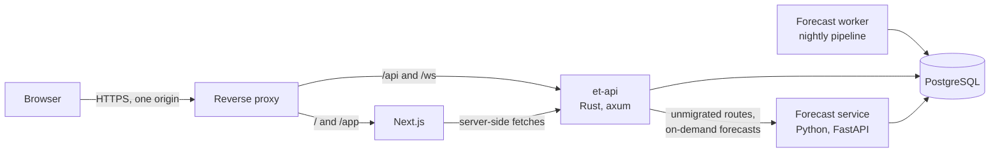
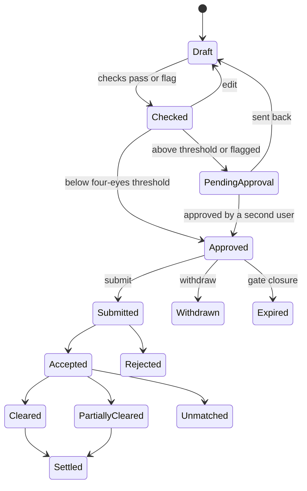

# Roadmap

This document plans the next stage of EnergyTrader: a Rust trading core, a trade blotter, and a public landing page with authenticated access.
It also records known modeling issues that the new work should fix rather than carry forward.
Each section states the decision, the reason for it, and how we will know it worked.

## 1. Context

### Current state

The backend is a single FastAPI process on Python 3.13 that owns everything: scrapers, feature engineering, per-segment gradient-boosted models, the bid LP, DSM policy, pre-trade checks, risk, audit and a nightly APScheduler pipeline.
Storage is one SQLite file whose schema comes from `Base.metadata.create_all`, with no migrations.
There is no authentication, and every audit entry records the user as `trader` (`backend/common/models.py`).
Submitting a bid set writes rows to the `bids` table with status `submitted` and an audit entry; nothing is sent to an exchange.
Model training runs inside the API process, so a long retrain competes with interactive requests.

A walk-forward backtest over 1 to 28 October 2026 gives a MAPE of 13.8% for DAM, 28.4% for RTM and 14.6% for TAM, with R² of 0.88, 0.70 and 0.05.
Eleven of those 28 days fall inside the training window, so these figures are optimistic and only the held-out days should be quoted.

### Goals

1. Make the bid lifecycle correct by construction: typed units, decimal money, an explicit state machine, and an append-only record of who did what.
2. Give traders and risk one blotter that shows every order, its status and its outcome, updated live.
3. Put the workstation behind login with roles and four-eyes approval, so the audit trail names real people.
4. Fix the buy-side modeling issues in section 2 before anyone relies on the recommendations.

### Non-goals

- Order routing to an exchange and settlement with it; see phase 5.
- Rewriting forecasting in Rust, since Python's ML ecosystem is the right tool for it.
- Multi-tenancy, self-service signup or billing.
- Horizontal scale; at 96 blocks a day there are about 35 thousand price rows per segment per year, so one instance per service is enough.

## 2. Known modeling issues

### 2.1 The LP objective rewards expensive volume

`backend/bid_engine_service/optimizer.py` minimizes `Σ -bid_price[b]·v[b]` plus DSM and uncertainty terms, which means it maximizes bid price times volume.
For a buyer this is backwards: the solver prefers to place volume in the blocks where it expects to pay the most, up to `per_block_cap`, and only the DSM terms pull the schedule back toward load.
The total-volume constraint `Σ v[b] ≤ demand_mw × volume_scale` is an upper bound, so the objective also pushes total volume to that cap rather than to what the load needs.
Bid prices are fixed before the solve as forecast plus `price_offset × volatility`, so price is not a decision at all.
In a uniform-price auction a cleared buyer pays the clearing price, not its bid, so `bid_price × volume` is not even the cost of the schedule.

The replacement minimizes the expected cost of serving the load, where energy not bought in the day-ahead market has to come from somewhere else:

```text
Per block b, with block duration h = 0.25 hours:
  L[b]   load to serve, MW
  p[b]   expected DAM clearing price, INR/MWh
  r[b]   expected cost of energy not bought in DAM (RTM price or the DSM reference rate), INR/MWh
  σ[b]   DAM price uncertainty, INR/MWh
  ρ      share of over-procured energy recovered through settlement, 0 to 1

Variables, all ≥ 0, in MW:
  q[b]         volume bought in DAM
  u[b], o[b]   under- and over-procurement against L[b]
  e[b], s[b]   deviation beyond the band and beyond the severe threshold

minimize  Σ_b h · ( p[b]·q[b] + r[b]·u[b] - ρ·r[b]·o[b]
                    + λ1 · penalty_rate · r[b] · (e[b] + (multiplier - 1)·s[b])
                    + λ2 · σ[b] · q[b] )

subject to
  q[b] - L[b] = o[b] - u[b]
  e[b] ≥ u[b] + o[b] - deviation_band · L[b]
  s[b] ≥ u[b] + o[b] - severe_threshold · L[b]
  q[b] ≤ cap[b], and the technical minimum where it applies
```

The buyer's reservation price for a block is then the expected cost of the alternative, `r[b]` plus expected DSM charges, rather than the forecast plus an offset.
Solving the LP over a grid of DAM price levels gives the quantity the buyer should hold at each price, which is a monotone demand curve and exactly what a portfolio bid expresses (see 2.5).
Strategies then differ in risk appetite, not in a price offset.
Once quantile forecasts exist (2.3), the same model becomes a scenario LP, and a CVaR limit can replace the `λ2·σ` term while keeping the problem linear.

### 2.2 Demand is a daily total split evenly over blocks

The optimizer sets `load_per_block = demand_mw / NUM_BLOCKS`, and the workstation labels the input "Total Demand" with a default of 500 (`frontend/src/app/page.tsx`).
MW is a rate, so a 500 MW load needs 500 MW in every block, not 5.2 MW, and summing MW across blocks has no physical meaning.
The replacement is a per-block load schedule in MW, either from a load forecast produced by the forecast service or uploaded as 96 values.
The schedule is stored with the bid set, so validation, checks, risk and post-market review all measure deviation against the same baseline.

### 2.3 Forecast intervals are not calibrated

`PriceForecastModel.predict` in `backend/forecast_service/model.py` sets σ to the larger of half the block's 7-day price standard deviation and 8% of the prediction, and reports `prediction ± 1.96σ`.
Nothing checks that 95% of outcomes actually land inside that band.
The plan is to train quantile models (`HistGradientBoostingRegressor(loss="quantile")` at 0.05, 0.5 and 0.95) and calibrate them with split-conformal residuals from the walk-forward backtest, per segment and time-of-day bucket.
The Backtest page reports empirical coverage and mean interval width next to MAPE, and a retrained model is promoted only if held-out coverage is within 3 points of nominal.

Two related forecasting gaps belong in the same piece of work:

- Training uses observed weather from enriched rows, while prediction uses Open-Meteo forecasts or NaN when that call fails (`docs/FEATURES.md`).
  Training on archived as-of forecasts removes the skew; until then, the backtest should run with forecast weather so the number is honest.
- TAM has an R² of 0.05, and TAM contracts do not trade as a 96-block auction.
  Every model should be reported against a seasonal-naive baseline (same block, last week), and TAM recommendations should be withheld unless the model beats it.

### 2.4 DSM exposure uses price uncertainty as a volume proxy

`backend/risk_service/engine.py` assumes drawal deviates from schedule by the price forecast's relative half-width, clamped to 2 to 25%.
Price uncertainty and volume deviation are different quantities, so the expected DSM penalty is not tied to anything that causes deviation.
Deviation should come from the load forecast's error distribution, and uncleared volume from price scenarios evaluated against the bid curve.
Cost-at-risk assumes block errors are perfectly correlated, which is a safe upper bound; scenarios built from backtest residuals give both a realistic VaR and the CVaR used in 2.1.

### 2.5 Bids are single price-quantity points

Day-ahead and real-time markets on IEX accept portfolio bids as price-quantity pairs per block, as well as block bids across consecutive blocks, and clear by bid area with market splitting.
The platform submits one point per block, treats a bid as cleared when its price is at least the MCP, and ignores area prices.
The Rust domain models every order as a curve from day one, with a single point being a one-step curve, so curves need no schema change later.
Price history gains a bid-area column so that area clearing prices can be stored once they are scraped.

### 2.6 Policy edits overwrite history

`update_policy` in `backend/common/dsm_policy.py` rewrites the YAML file in place, and a bid set does not record the policy it was checked against.
After an edit, nobody can reproduce why a past bid set passed its checks.
Policies become immutable versions: an edit creates a new version, activation is an event, and every check result references the version it used.

## 3. Rust trading core

### 3.1 Why Rust

Speed is not the reason.
The LP has under 500 variables and HiGHS solves it in milliseconds from Python, and request latency is dominated by the database and model inference.
The reason is correctness in the part of the system that commits money:

- Unit newtypes make `MW + MWh` a compile error.
- Decimal money removes float rounding from prices, costs and penalties.
- An exhaustive `match` over lifecycle states means a new state cannot be forgotten in a handler.
- `sqlx` checks queries against the schema at compile time.
- One static binary with predictable memory is a good host for a long-lived WebSocket hub.

The cost is a second language, toolchain and deploy unit, which the strict service boundary below keeps contained.

### 3.2 Separate service rather than PyO3

The trading core runs as its own service, `et-api`, rather than as a PyO3 extension inside FastAPI.
With PyO3, the Python process would still own the request, the transaction and the session, and Rust would only be a library of pure functions, so the type guarantees would stop at the function boundary.
A separate service also isolates failures, so a memory-hungry retrain or a stuck scraper cannot stall order entry.
It releases independently, and it ships as a plain container instead of platform-specific maturin wheels.
PyO3 remains the right tool if a numeric kernel inside forecasting ever needs to be faster, which is not the case today.

### 3.3 Topology



`et-api` is the only upstream for `/api`, so it acts as the strangler-fig facade.
It authenticates every request, serves the routes it owns, and forwards the rest to the forecast service with the authenticated actor in an internal header.
The forecast service listens only on the private network and accepts requests only with the internal service token.
Routing at the facade keeps auth in one place, leaves the Next.js config unchanged at each cutover, and guarantees that Python never sees an unauthenticated request.
In local development without the proxy, the existing Next.js rewrite sends `/api` to `et-api`, and the browser opens the WebSocket against `et-api` directly.

### 3.4 Crate layout

The Rust code lives in a Cargo workspace under `crates/`, next to `backend/` (the forecast service), `frontend/`, `migrations/` and `contracts/`.

| Crate | Responsibility | Depends on | External crates |
| --- | --- | --- | --- |
| `et-domain` | Units, segments, blocks, delivery calendar and gate closure, bid sets, orders, lifecycle state machine, commands and events | none | `rust_decimal`, `serde`, `time` |
| `et-policy` | Policy versions, DSM penalty math, bid validation | `et-domain` | none |
| `et-risk` | Cost-at-risk, DSM exposure, pre-trade checks and verdict | `et-domain`, `et-policy` | none |
| `et-optimizer` | LP formulations, strategy versions, rounding to tick and lot | `et-domain`, `et-policy` | `good_lp` with the HiGHS backend |
| `et-clearing` | Clearing simulator over recorded prices, curve evaluation, strategy backtests | `et-domain`, `et-policy` | none |
| `et-store` | Postgres access, event store, projections, forecast contract reads | `et-domain` | `sqlx` |
| `et-api` | HTTP and WebSocket API, auth, sessions, authorization, facade proxy, OpenAPI | all of the above | `axum`, `tokio`, `tower-http`, `reqwest`, `argon2`, `utoipa`, `tracing` |

Only `et-store` and `et-api` perform I/O, so the domain, policy, risk, optimizer and clearing crates are deterministic and property-testable.

### 3.5 Units, money and time

Quantities are newtypes over `rust_decimal::Decimal`: `Mw`, `Mwh`, `InrPerMwh` and `Inr`.
Only meaningful operations exist, such as `Mw × BlockDuration → Mwh` and `Mwh × InrPerMwh → Inr`.
Postgres stores them as `numeric` in exchange-native units, which means INR/MWh for prices, whereas the current schema stores INR/kWh (`PriceHistory.mcp`); the UI can keep displaying INR/kWh.
The solver works in `f64`, and its output is rounded to the segment's price tick and volume lot and then re-validated in `Decimal`, so validation, not the solver, is authoritative.
A `Block` is constructed only for values 1 to 96, and a delivery date plus block maps to a UTC interval.
IST is a fixed UTC+05:30 offset with no daylight saving, so no time zone database is needed; timestamps are stored as `timestamptz` in UTC and displayed in IST.

### 3.6 Bid lifecycle

The bid set is the unit that is checked, approved and submitted, and it moves through this state machine:



`Draft`, `Checked` and `PendingApproval` can also be withdrawn or expire at gate closure; the diagram shows those exits only from `Approved` to stay readable.

A check result is bound to a content hash of the orders, the load schedule, the policy version and the forecast run.
Approval references that hash, so any edit returns the set to `Draft` and an approval can never be reused for different bids.
Gate closure comes from a market calendar per segment and session, and commands that arrive after it are rejected.
Transitions are implemented as `fn handle(state, command, actor) -> Result<Vec<Event>, DomainError>` with an exhaustive match, and state is the fold of the stream's events.
A typestate encoding was considered and rejected, because state is loaded from the database at runtime and the enum is simpler to read.
Each order carries its own clearing status, and the bid set's `Cleared`, `PartiallyCleared` or `Unmatched` state is the rollup over its orders.
Until exchange connectivity exists, `et-clearing` plays the exchange: it accepts submitted sets and clears them against published prices.

### 3.7 Event store

```sql
create table events (
    id             bigint generated always as identity primary key,
    stream_type    text        not null,  -- bid_set, policy, user
    stream_id      uuid        not null,
    version        integer     not null,
    event_type     text        not null,  -- e.g. BidSetSubmitted.v1
    payload        jsonb       not null,
    actor_kind     text        not null,  -- user or system
    actor_id       text        not null,
    correlation_id uuid        not null,
    occurred_at    timestamptz not null default now(),
    unique (stream_id, version)
);
```

The unique `(stream_id, version)` constraint gives optimistic concurrency, so a racing approve and withdraw cannot both succeed and the loser gets a `409`.
The application role has only `insert` and `select` on `events`, and a trigger rejects updates and deletes.
Projections such as `bid_sets`, `orders`, `blotter_rows` and the audit view are updated in the same transaction as the append, so reads never lag writes, and any projection can be rebuilt by replay.
After commit, `pg_notify` wakes the WebSocket hub.
Event types carry a version suffix, and old versions are upcast on read.
Only bid sets, policy versions and users are event-sourced; market data, forecasts and model runs stay as plain tables, because event-sourcing them adds cost without a use.
The existing `bids` and `audit_log` rows are imported once as `Imported.v1` events, and `audit_log` becomes a read model over `events`.

### 3.8 What moves and what stays

| Capability | Today | Target |
| --- | --- | --- |
| Policy storage, versions and penalty math | `common/dsm_policy.py` | `et-policy`, versions in Postgres |
| Bid validation | `bid_engine_service/optimizer.py` | `et-policy` |
| Pre-trade checks and verdict | `approval_service/checks.py` | `et-risk` |
| Cost-at-risk and DSM exposure | `risk_service/engine.py` | `et-risk` |
| Bid optimization | `bid_engine_service/optimizer.py` | `et-optimizer`, parity first, then 2.1 |
| Submission and lifecycle | `bid_engine_service/router.py` | `et-api` and `et-store` |
| Audit log and post-market review | `audit_service/router.py` | `et-api` and `et-clearing` |
| Auth, sessions, blotter, WebSocket | none | `et-api` |
| Scrapers, enrichment, training, prediction, backtest | Python | stays in the forecast service |
| Nightly pipeline | APScheduler inside the API process | stays in Python, as a separate worker process |

Policies move from YAML files into Postgres as immutable versions, and the existing YAML files are imported once.
That also avoids a YAML dependency in Rust, where the main serde YAML crate is no longer maintained.

### 3.9 Contracts

The forecast service publishes runs to `forecast_runs` and `forecast_points`, with `p05`, `p50` and `p95` per block, a model version and a `published_at` timestamp.
`et-api` reads forecasts only through a `published_forecasts` view and never touches the forecast service's internal tables.
The view mirrors a versioned JSON Schema in `contracts/forecast.v1.json`, and both services run contract tests against it.
The database is the integration point rather than HTTP, so optimization and checks keep working on the last published forecast if the forecast service is down, and the forecast is read in the same transaction as the bid set.
On-demand forecasts go through `et-api` to the forecast service, which writes a run and returns its ID.

`et-api` serves OpenAPI 3.1 generated by `utoipa` from the handler types.
The frontend generates its TypeScript types with `openapi-typescript`, a development-only dependency, and CI fails if the committed types are stale.
This replaces the handwritten types in `frontend/src/lib/api.ts`, which can drift from the backend silently.

### 3.10 Migration

1. Record: a middleware in the forecast service writes request and response pairs for the routes being migrated to JSONL fixtures, captured against a seeded database snapshot.
2. Implement the route in Rust while the facade still forwards it to Python.
3. Shadow read-only routes: the facade calls both, returns Python's response, and logs any difference.
4. Prove parity in CI by replaying the fixtures against Rust.
   Verdicts and check statuses must match exactly, and money and prices must match to the tick.
   LP results are compared on objective value (relative tolerance 1e-6) and constraint satisfaction rather than exact volumes, because degenerate LPs have more than one optimum.
5. Cut over by flipping the route's entry in the facade's routing table, keeping the Python route for one release as a rollback.
6. Retire the Python router and its tests after one release without a rollback.

The order is read-only routes first (policy list, active and compare, audit log), then validation, risk and pre-trade checks, then submission, where the event store and four-eyes approval start.
After that comes the optimizer (`recommend`, `tune` and `compare-strategies`), then post-market review.

## 4. Trade blotter

### 4.1 Purpose

The blotter answers what was bid, who approved it, what cleared at what price, and what it cost, for today's sessions and for history.
Traders use it to watch live sessions, risk uses it to review approvals and exposure, and operations uses it for reconciliation.

### 4.2 Row model

A row is one order, which is one block of one bid set, and the UI groups rows by bid set.

| Field | Meaning |
| --- | --- |
| `order_id`, `bid_set_id` | Order and bid set identifiers; `bid_set_id` is today's `session_id` |
| `market_session` | Auction the order belongs to, such as DAM for a delivery date or an RTM session |
| `segment`, `delivery_date`, `block` | Where and when the energy is delivered, with the IST window shown alongside |
| `side` | Buy today; sell is reserved |
| `price`, `curve_steps` | Top price in INR/MWh, and the number of curve steps |
| `quantity_mw`, `energy_mwh` | Bid quantity and the energy it represents |
| `strategy`, `overridden`, `override_reason` | How the order was produced and whether a person changed it |
| `verdict`, `policy_version` | Pre-trade verdict and the policy version it was checked against |
| `status` | Lifecycle state of the order |
| `submitted_by`, `approved_by` | Actors; approval is empty when it was automatic |
| `created_at`, `checked_at`, `approved_at`, `submitted_at`, `results_at` | Lifecycle timestamps in UTC |
| `cleared_mw`, `clearing_price` | Cleared quantity and clearing price (MCP, or area price once stored) |
| `forecast_p50`, `slippage` | Forecast at submission and clearing price minus forecast |
| `dsm_expected`, `dsm_uncleared` | Expected DSM exposure at check time and the realized exposure of uncleared volume, in INR |
| `cost`, `cost_vs_benchmark` | Cleared energy times clearing price, and the saving against the benchmark, in INR |

In a uniform-price auction a cleared buyer pays the clearing price, so bid price minus clearing price is headroom, not profit.
The blotter therefore reports cost against a benchmark, by default buying the same energy at the RTM price for the same block, which is the buyer's realistic alternative.
The benchmark is configurable, and a positive value means day-ahead procurement saved money.

### 4.3 Where rows come from

In phase 2, before the event store exists, a `blotter_v1` view joins `bids`, the submit entries in `audit_log`, cleared prices from `price_history`, the latest forecast before submission, and `risk_snapshots`.
Clearing status in that view is derived as bid price at least the MCP, `approved_by` is empty, and rows submitted before login existed show the actor as `imported`.
In phase 3, `et-store` maintains `blotter_rows` as a projection inside the append transaction, with the same API shape, so the UI does not change.

### 4.4 API

- `GET /api/blotter` filters by delivery date range, segment, status, trader, verdict, bid set and free text, with a fixed set of sort keys.
  It returns `{ rows, next_cursor, as_of_event_id, totals }` with keyset pagination on the sort key plus `order_id`, encoded as an opaque cursor, and a limit of at most 500.
  Offsets are not supported, because they skip or repeat rows while new orders arrive.
- `GET /api/blotter/{order_id}` returns the row with its event history, the check results it was approved on, and the forecast and clearing context for its block.
- `GET /api/blotter/export.csv` takes the same filters and streams the whole result, with units in the column names and timestamps in both UTC ISO 8601 and IST.
- `WS /ws/blotter` starts with the client sending `{ "type": "subscribe", "filters": ..., "since": <as_of_event_id> }`.
  The server replays any matching events after `since` from the event table, then streams `upsert` messages tagged with `event_id`, plus a heartbeat every 15 seconds.
  The client drops messages it has already applied, so a REST snapshot followed by a subscription never misses or double-counts an update.
  A client that falls behind its bounded buffer receives `resync` and refetches over REST, so one slow browser cannot hold memory on the server.

### 4.5 UI

- The blotter lives at `/app/blotter` and uses the full content width with a sticky header, a sticky identifier column, 28-pixel rows, tabular numerals and right-aligned numbers.
- Rendering uses TanStack Table and TanStack Virtual; both are headless and small, and hand-rolling virtualization with grouping and sticky columns would be substantially worse.
- A column chooser controls visibility and order, saved per user on the server so it follows them between machines.
- Filters live in the URL query string, so a filtered view can be shared or bookmarked.
- Grouping by bid set shows an aggregate row with block range, energy, volume-weighted clearing price and a status rollup, and it expands to the orders.
- Live updates flash the changed cells briefly without shifting layout.
  While the user is scrolled away from the top or has a row focused, new rows are held behind an "N new updates" pill instead of reordering under the cursor.
- Selecting a row opens a side panel with the event timeline (actor and IST time), the check results at approval, a forecast versus bid versus clearing chart for that block, and the risk snapshot.
- CSV export downloads the current filter, not just the loaded page.
- Arrow keys or `j` and `k` move between rows, `Enter` opens the panel, `Esc` closes it, `/` focuses search, and `?` lists shortcuts.
- The table uses `role="grid"` with `aria-rowcount` and `aria-rowindex`, so screen readers handle the virtualized rows.
- The status bar shows the WebSocket state and the time of the last update, and a stale-data banner appears if the connection drops.

### 4.6 Performance targets

Three segments, 96 blocks and a few bid sets per day come to about 300 thousand orders per year, which sets the scale for these targets.

| Measure | Target |
| --- | --- |
| `GET /api/blotter` first page of 200 rows over 300 thousand orders | p95 under 100 ms at the server |
| Event commit to updated cell in the browser | p95 under 250 ms on the office network |
| Scrolling 10 thousand loaded rows | 60 frames per second on a mid-range laptop |
| WebSocket clients per `et-api` instance | 500, with resident memory under 200 MB |
| CSV export of 300 thousand orders | first byte in under 1 second |

## 5. Landing page and authenticated access

### 5.1 Routes

The public landing page is `/`, sign-in is `/login`, and the workstation moves under `/app`.
Today's `/`, `/forecast`, `/risk`, `/sync`, `/backtest`, `/analysis` and `/policy` move to `/app/...`, with permanent redirects from the old paths, like the existing `/bids` redirect in `frontend/next.config.js`.
A path prefix gives the middleware a single matcher, lets the landing page render statically, and removes any list of public routes to keep in sync.
Next.js route groups were considered, but they do not change URLs, so the middleware would need a per-route list.

The landing page states what the product does, walks through the workflow (forecast, optimize, check, approve, submit, review) with screenshots from `docs/screenshots`, states that it does not route orders to an exchange, and offers a sign-in button.
It loads no third-party scripts or trackers, and it quotes only accuracy figures from held-out backtests.

### 5.2 Middleware

Next.js middleware on `/app/:path*` checks only that the session cookie is present, and redirects to `/login?next=<path>` when it is not.
It does not validate the session, because `et-api` validates every API call and returns `401`, which the API client turns into the same redirect.
The `next` parameter is honored only when it is a relative path starting with `/app/`, which prevents open redirects.
Server components that fetch data forward the cookie to `et-api`.

### 5.3 Accounts and passwords

An admin creates accounts, and there is no self-signup.
The first admin is created with an `et-api admin create` command that reads the password from standard input.
Passwords are hashed with argon2id using the RustCrypto `argon2` crate, with at least the OWASP baseline of 19 MiB memory, two iterations and one lane, tuned to about 100 ms on production hardware.
The PHC string stores the parameters, so they can be raised later and hashes upgraded on the next successful login.
Passwords need at least 12 characters with no composition rules, following NIST SP 800-63B, and are rejected if they appear in a bundled list of common passwords.
For an unknown account, the server verifies against a dummy hash so response time does not reveal whether the account exists, and every failure returns the same message.
Password reset uses an admin-issued, single-use link token that is stored hashed and expires after 24 hours, so no email delivery is required.

### 5.4 Sessions

A session token is 256 random bits, base64url-encoded, and the database stores only its SHA-256 hash, so a database read does not yield usable sessions.
The cookie is `__Host-et_session` with `HttpOnly`, `Secure`, `SameSite=Lax`, `Path=/` and no `Domain`.
In local development over plain HTTP, one config flag drops the `__Host-` prefix and the `Secure` attribute.
Every login creates a new session, which prevents session fixation, and a role or password change rotates it.
A password change also revokes every other session for that user.
Sessions expire after 60 minutes idle or 12 hours absolute, which covers a trading day and forces a fresh login each day.
`last_seen_at` is written at most once a minute to avoid a database write on every request.
Logout deletes the session row, and an admin can revoke all sessions for a user.

### 5.5 CSRF

The defense is `SameSite=Lax`, an origin check on every state-changing request, and JSON-only request bodies, with no CSRF tokens.
`SameSite=Lax` keeps the cookie off cross-site `POST`, `PUT` and `DELETE` requests and off cross-site subresource requests.
Lax still sends the cookie on top-level cross-site `GET` navigations, so `GET` handlers must not change state, and a test walks the router to enforce that.
Sibling subdomains count as same-site, so `et-api` also requires `Origin`, or `Sec-Fetch-Site: same-origin`, to match the configured public origin on every request other than `GET` and `HEAD`, and rejects the request when both headers are missing.
Mutating endpoints accept only `application/json`, which a cross-origin form cannot send without a preflight, and `et-api` allows no cross-origin requests.
Double-submit tokens add a round trip without covering any case the origin check misses in a single-origin deployment, so they are deferred until the API is ever served cross-origin.

### 5.6 Rate limiting and lockout

Login attempts are limited per IP with a token bucket of 10 per minute, and failures are counted per account.
After 5 consecutive failures the account is locked with exponential backoff from 1 minute up to 30 minutes, rather than permanently, so nobody can lock a trader out before gate closure.
Counters live in Postgres, so they survive restarts and are shared across instances, and a successful login resets them.
Expensive endpoints such as tuning, training and backtests have per-session limits that protect the solver and model workers.
Login success and failure, lockout, logout, password changes and role changes are all audit events.

### 5.7 Roles and authorization

There are four roles: `viewer`, `trader`, `risk` and `admin`, and a user can hold more than one.
`admin` manages users and the system and grants no trading rights, which keeps duties separate.

| Action | viewer | trader | risk | admin |
| --- | --- | --- | --- | --- |
| View workstation, forecasts, backtests, blotter | ✓ | ✓ | ✓ | ✓ |
| Export the blotter | | ✓ | ✓ | ✓ |
| Sync market data and train models | | ✓ | | ✓ |
| Build, edit and check bid sets | | ✓ | | |
| Submit a bid set | | ✓ | | |
| Approve a bid set | | | ✓ | |
| Withdraw a bid set before gate closure | | own sets | ✓ | |
| Edit or activate DSM policy and risk limits | | | ✓ | |
| Manage users, roles and sessions | | | | ✓ |
| View the audit log | | ✓ | ✓ | ✓ |

Authorization is denied by default.
Every route declares the permission it needs, and a test enumerates the router to make sure none is missing.
Command handlers also receive the `Actor` with its roles and check permissions inside the domain, so a new route cannot bypass them.

### 5.8 Four-eyes approval

A bid set needs approval from a second user with the `risk` role when its total exposure exceeds `FOUR_EYES_THRESHOLD_INR` or its verdict is `APPROVED_WITH_FLAGS`.
The approver must differ from the submitter, which is enforced in the state machine and again by a check constraint on the projection.
Approval binds to the content hash from 3.6, and it lapses at gate closure.
Below the threshold, approval is automatic and recorded as an `AutoApproved` event naming the rule that allowed it.

### 5.9 Audit actor

Every event records `actor_kind` and `actor_id`, and system work such as the nightly pipeline runs as a named system principal, never as a null actor.
Requests forwarded to the forecast service carry the actor in an internal header set by `et-api`, and the facade strips any copy of that header from inbound requests.
The `trader` default on `audit_log.user` goes away.

### 5.10 Authenticated WebSocket

The browser sends the session cookie with the upgrade request, and `et-api` validates the session and role before upgrading.
The `Origin` header is checked against the allow-list on upgrade, because WebSockets are not covered by CORS and would otherwise be open to cross-site hijacking.
The connection is bound to its session, and `et-api` closes it with code 4401 when the session expires or is revoked, with revocation delivered over `LISTEN/NOTIFY`.
The client then redirects to `/login`.

### 5.11 Where auth lives and SSO later

`et-api` owns users, sessions and authorization.
Next.js middleware only checks that the cookie is present and forwards it, and the forecast service trusts only `et-api` over the private network.
Single sign-on can come later through OIDC with the authorization code flow and PKCE, mapping identity-provider groups to roles.
Local password accounts then remain only as a break-glass admin.

## 6. Delivery plan

Sizes assume one engineer working full time.

| Phase | Scope | Exit criteria | Size |
| --- | --- | --- | --- |
| 1. Foundations | Postgres with SQL migrations and a one-off SQLite import; `et-api` skeleton as a pass-through facade; users, sessions, roles and login; landing page, `/login` and the `/app` move; actors on audit entries; Docker Compose | Every current workflow passes an end-to-end test behind login; the forecast service is reachable only from `et-api`; imported row counts reconcile; CI runs migrations and both test suites against Postgres | 3 to 4 weeks |
| 2. Blotter on existing data | `blotter_v1` view, list, detail and CSV endpoints, the blotter UI with 10-second polling | All historical bid sets appear with derived clearing status; performance targets hold on 300 thousand seeded orders; keyboard and accessibility checks pass | 2 weeks |
| 3. Rust core | `et-domain`, `et-policy` with immutable versions, `et-risk`, `et-store` and the event store; parity fixtures and route-by-route cutover; lifecycle and four-eyes approval; the WebSocket blotter; optimizer parity | Python policy, approval, risk and bid routers are deleted; the parity suite and property tests pass in CI; four-eyes approval is enforced; WebSocket targets are met | 6 to 8 weeks |
| 4. Modeling | Buyer LP and per-block load schedule as a new strategy version; quantile intervals with conformal calibration; scenario risk; strategy backtests through `et-clearing` | Over at least 90 walk-forward delivery days, the new formulation costs less in procurement, RTM cover and DSM than the current one at equal or lower CVaR; 95% intervals cover 92 to 98% of held-out outcomes; the old formulation is retired | 4 to 6 weeks |
| 5. Market access | Bid curves and block bids in the optimizer and UI; bid areas and area prices; order routing through an exchange member; reconciliation with exchange obligation reports; settlement | Defined once exchange access is arranged | Not sized |

Phase 2 reads existing tables only, so it can run alongside the early, pure-crate part of phase 3.
Phase 5 depends on a commercial relationship with an exchange member as much as on engineering.

## 7. Testing and operations

### 7.1 Tests

- Property tests with `proptest` cover the policy math: penalties are zero without deviation, never decrease as deviation grows, are continuous at the band edges, scale linearly with price and duration, and the severe tier never costs less than the base tier.
- Random command sequences against the state machine never reach an illegal state, and a submitter can never approve their own set.
- Every LP solution satisfies its constraints, and its objective is never worse than the uniform fallback.
- Parity tests replay the recorded fixtures from 3.10.
- Contract tests validate forecast runs against the JSON Schema and fail on OpenAPI drift.
- `et-store` tests run against a real Postgres in CI, with no database mocks.
- Playwright covers the full flow: a trader forecasts, optimizes, checks and submits a set above the threshold, a risk user approves it in a second browser context, and the trader's blotter updates live.
  The same suite covers refusals: a viewer cannot submit and a trader cannot approve their own set.
- A small `et-loadtest` binary drives 500 WebSocket clients at 20 events per second and reports commit-to-receive latency and server memory; it runs nightly rather than on every pull request.
- Dependency audits run in CI for Cargo, npm and Python.

### 7.2 Observability

Services log structured JSON through `tracing` on the Rust side and the standard logging module on the Python side, with a request ID on every line.
W3C `traceparent` headers propagate from Next.js through `et-api` to the forecast service, and traces and metrics export over OTLP to an OpenTelemetry collector.
Key metrics are latency and errors per route, solver time and status, how often the uniform fallback is used, verdict counts, WebSocket connections and send lag, event append rate, and forecast freshness per segment.
Alerts fire when no forecast for the next delivery day has been published a configured time before gate closure, when a nightly job fails, when the solver falls back, and when login failures spike.
`/healthz` reports liveness, and `/readyz` checks the database, the migration version and the forecast service.

### 7.3 Deployment

`et-api` builds in a multi-stage Dockerfile with `cargo-chef` layer caching onto a distroless runtime image.
The forecast service and its worker build on a slim Python image with `uv`, and the web app uses Next.js standalone output.
Migrations run as a one-shot job before the services start.
`docker-compose.yml` runs Postgres, migrations, `et-api`, the forecast service, the forecast worker, the web app and the reverse proxy locally, and `make dev` remains the entry point.
The nightly pipeline moves out of the API process into the forecast worker.
Any hosted environment is defined as code, and secrets come from the environment or a secret manager, never from images.
Postgres uses WAL archiving for point-in-time recovery, because the event store is the system of record, and a scheduled job proves that a restore works.

## 8. Open questions

1. Who is the primary user: a distribution utility's procurement desk that only buys, a trader that buys and sells, or a generator that sells?
   The data model reserves `side`, but the optimizer formulation differs for each.
2. Where does the per-block load schedule come from: an internal load forecast, the utility's own schedule, or uploads?
3. Which markets come first: IEX only, or other exchanges as well, and should TAM stay in the optimizer given its forecast accuracy?
4. Should RTM be optimized per half-hourly auction rather than as a day of 96 blocks?
5. What are the four-eyes threshold and the session lifetimes the desk will accept?
6. What hosting target and identity provider should phase 1 assume?
7. How long must events and market data be retained for regulatory record keeping?
